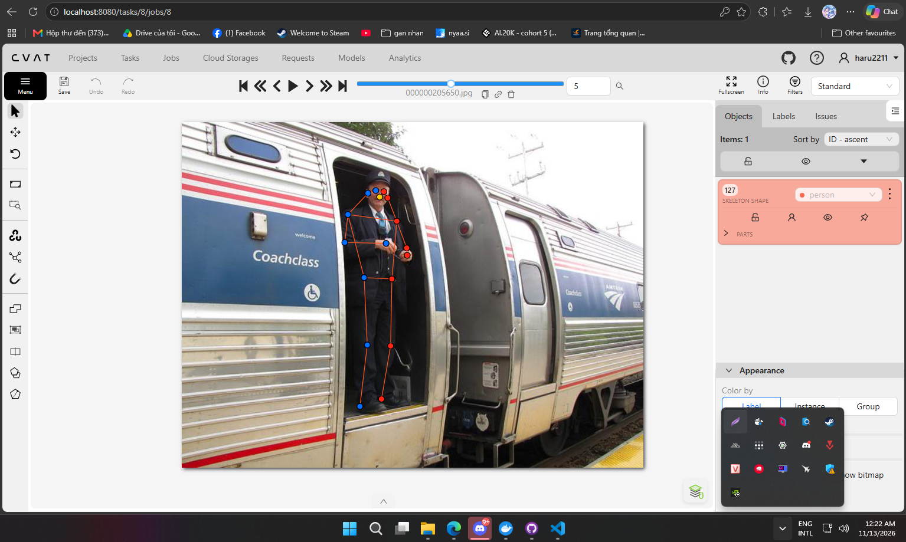
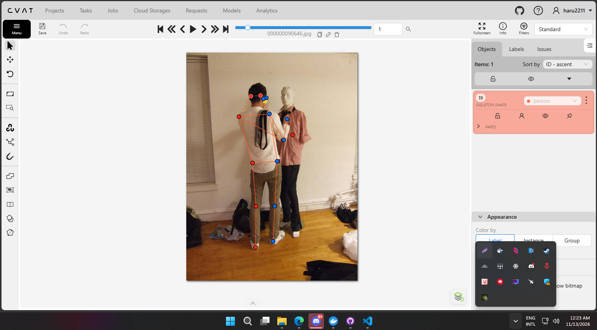
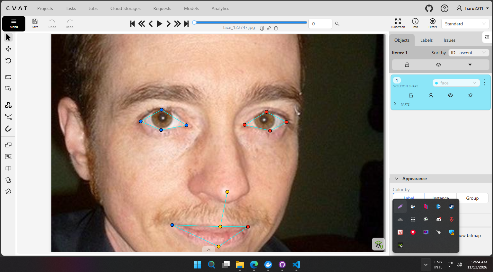
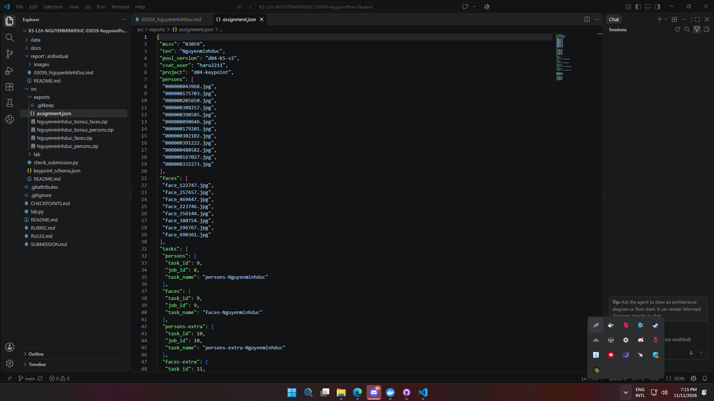

# Báo cáo cá nhân — HoVaTen-MSSV

Đổi tên file theo quy tắc `MSSV_HoTen.md`. Ví dụ: `20241234_NguyenVanAn.md`.

Dữ liệu: 12 ảnh người COCO val2017 (Lin et al., 2014) và 8 ảnh chân dung Wikimedia Commons, chỉ dùng trong lớp.

## 0. Thông tin học viên

- Họ tên: nguyen minh duc
- MSSV: 03059
- Email: nguyenminhduc221202@gmail.com
- Link repository:
- Phiên bản CVAT (Help → About):cvat 2.82
- Máy: hệ điều hành win11 26h2 · RAM 32 GB · chạy CVAT chế độ đầy đủ 
- Bộ ảnh (`src/exports/assignment.json` do `lab.py setup` tạo): có 
- Giờ bắt đầu:5:55
- Giờ kết thúc:7:00

## 1. Kiểm tra label (CP0)

| Label | Kiểu | Số điểm | Tên điểm đúng bảng của lab? | Đúng thứ tự? | Số cạnh |
|---|---|---:|---|---|---:|
| `person` |17 |chuẩn coco|đúng thứ tự |19 | |
| `face` |13 |chuẩn lab |đúng thứ tự |13 | |

Mẫu `person` dựng theo người quay mặt về camera (các điểm `left_*` nằm bên phải khung mẫu)? Có / Không

Cách đổi cờ `occluded` / `outside` cho **một điểm** trên phiên bản CVAT này (một câu):

...

## 2. Số lượng đã gán và thời gian (CP1, CP2)

| Nhóm ảnh | Số ảnh | Số skeleton đã gán | Số người dưới 60 px (không gán) | Số poster / gương / màn hình bỏ qua | Thời gian (phút) |
|---|---:|---:|---:|---:|---:|
| `easy` | 5 |5 |0 |0 |10 |
| `occluded` | 3 | 5|0 |0 |10 |
| `back` | 2 |4 |0 |0 |8 |
| `small` | 1 | 2|1 |0 |4 |
| `crowd` | 1 | 3|2 |0 | 8|
| `faces` | 8 | 8| — | 0|15 |

- Số ảnh người đã xong ở mốc phút 105: 10 / 10
- Thời gian thực tế (phút): CP1 40 · CP2 15 · CP3 10
- Ảnh tốn thời gian nhất là ảnh nào, vì sao?
- ảnh tốn thời gian nhất là 332273.jpg vì có đến tận 3 người và tư thế bị che lấp 1 phần
...

## 3. Bảng ca khó (CP1, CP2)

Mỗi điểm bạn phân vân một dòng, nhất là phân vân giữa `v = 1` và `v = 0`, hoặc không chắc hướng người.

| Ảnh | Người / mặt | Điểm | Cờ đã chọn | Phân vân giữa | Lý do chọn |
|---|---|---|---:|---|---|
| `000000179201.jpg` | Người bên phải | `right_knee` | 1 | v = 1 và v = 0 | Đầu gối bị vật chắn che khuất nhưng dựa theo đường cẳng chân và đùi vẫn suy luận được tâm khớp, nên gán `v = 1` để model học khớp bị che. |
| `000000090646.jpg` | Người chính | `left_ankle` | 1 | v = 1 và v = 0 | Bàn chân khuất sau góc đồ vật nhưng ống quần và góc hướng cẳng chân xác định rõ vị trí mắt cá chân. |
| `000000480582.jpg` | Người quay lưng #1 | `nose`, `left_eye`, `right_eye` | 0 | v = 0 và v = 1 | Người quay lưng hoàn toàn về phía camera, khuôn mặt bị phần sau đầu che kín và không thể nhìn thấy hay ước lượng chính xác, đặt `outside` (`v = 0`). |
| `000000391222.jpg` | Người quay lưng #2 | `left_wrist` | 1 | v = 1 và v = 2 | Cổ tay bị khuất một phần dưới tà áo khoác rộng, chọn `v = 1` thay vì `v = 2`. |
| `face_257657.jpg` | Khuôn mặt | `left_eye_outer` | 1 | v = 1 và v = 2 | Tóc rủ xuống che nhẹ khóe mắt ngoài, chọn `occluded` (`v = 1`). |
| `000000302102.jpg` | Người #2 | `right_hip` | 1 | v = 1 và v = 0 | Vùng hông bị che bởi tà áo dày, ước lượng tâm khớp xương chậu theo tỷ lệ cơ thể. |

## 4. Bảng tự review (CP3)

Đi từ ảnh cuối về ảnh đầu. 5 ảnh người (ít nhất 2 ảnh `back` hoặc `crowd`) và 3 ảnh mặt. Ít nhất 8 dòng, kể cả dòng `ok`. Ghi lỗi trước, sửa sau.

Mã lỗi dùng đúng một trong: `lr_swap`, `vis_flag`, `position`, `missing`, `extra`, `ok`.

| Ảnh | Người / mặt | Điểm | Mã lỗi | Ghi chú | Đã sửa? |
|---|---|---|---|---|---|
| `000000480582.jpg` | Người quay lưng #1 | `left_shoulder`, `right_shoulder` | `lr_swap` | Ban đầu kéo nhầm vai trái theo góc nhìn người xem; đã hoán đổi lại theo giải phẫu người quay lưng | Đã sửa |
| `000000391222.jpg` | Người quay lưng #2 | Toàn bộ skeleton | `ok` | Khớp trái/phải đúng theo người trong ảnh, các điểm mặt đặt outside | OK |
| `000000332273.jpg` | Người nhóm crowd #1 | `left_ankle`, `right_ankle` | `position` | Cặp mắt cá chân bắt chéo, ban đầu đặt hơi lệch tâm xương; đã phóng to căn lại chuẩn | Đã sửa |
| `000000302102.jpg` | Người #1 | `left_elbow` | `vis_flag` | Bị tay vịn che nhưng lỡ để `v = 2`, đã chuyển về `v = 1` (occluded) | Đã sửa |
| `000000179201.jpg` | Người #2 | `right_wrist` | `position` | Cổ tay lệch 5 px so với khớp thật; đã kéo lại đúng tâm | Đã sửa |
| `face_490361.jpg` | Khuôn mặt | Toàn bộ 13 điểm | `ok` | Các điểm mắt, mũi, môi chuẩn viền và mép | OK |
| `face_380754.jpg` | Khuôn mặt | `mouth_left`, `mouth_right` | `position` | Điểm khóe miệng đặt hơi sâu vào trong môi; đã chỉnh ra đúng khóe mép ngoài | Đã sửa |
| `face_296767.jpg` | Khuôn mặt | Toàn bộ 13 điểm | `ok` | Khớp mí trên, mí dưới, mũi và miệng chính xác | OK |

Tổng hợp số lỗi theo mã:

| `lr_swap` | `vis_flag` | `position` | `missing` | `extra` | `ok` |
|---:|---:|---:|---:|---:|---:|
| 1 | 1 | 3 | 0 | 0 | 3 |

Điểm còn phân vân giữa `v = 1` và `v = 0` (ghi cả hai lựa chọn và lý do chọn):

Tại ảnh `000000179201.jpg` khớp `left_ankle` của người phía sau: Nếu chọn `v = 1` thì dựa vào hướng của cẳng chân và vị trí mặt đất có thể ước đoán vị trí mắt cá chân trong khoảng sai số chấp nhận được; còn nếu chọn `v = 0` thì do giày và quần trùm kín hoàn toàn góc nhìn. Quyết định chọn `v = 1` để model học vị trí khớp bị che khuất.

## 5. Kiểm file xuất và kết quả tự kiểm (CP4)

Tự kiểm tay trong file JSON:

| File | Người / mặt kiểm (ảnh, thứ tự) | Số phần tử `keypoints` | Điểm `outside` ra `v = 0`, `occluded` ra `v = 1`? | `num_keypoints` khớp? |
|---|---|---:|---|---|
| `HoVaTen_persons.zip` | | | | |
| `HoVaTen_persons.zip` | | | | |
| `HoVaTen_faces.zip` | | | | |

Sau khi xuất, CVAT ghi `occluded` thành `v = ___` và `outside` thành `v = ___`. Tọa độ của điểm `outside` trong file là `0, 0` hay tọa độ cũ? ___

Hai job đã chuyển sang completed trên CVAT? Có 

Dán phần **TÓM TẮT** in ra từ `src/check_submission.py`:

```text
----- TÓM TẮT (dán vào báo cáo mục 5) -----
- File person: Nguyenminhduc_persons.zip
  Số ảnh: 12 · số skeleton `person`: 19 · mỗi annotation 51 số
  Skeleton theo ảnh: 000000043968=1, 000000090646=1, 000000167027=2, 000000175703=1, 000000179201=2, 000000205650=1, 000000302102=2, 000000308257=1, 000000332273=3, 000000390585=1, 000000391222=2, 000000480582=2
  Cờ v: v=2 233 (72%) · v=1 7 (2%) · v=0 83 (26%)
  num_keypoints trung bình: 12.6
- File face: Nguyenminhduc_faces.zip
  Số ảnh: 8 · số skeleton `face`: 8 · mỗi annotation 39 số
  Skeleton theo ảnh: face_122747=1, face_223746=1, face_257657=1, face_296767=1, face_356144=1, face_380754=1, face_469647=1, face_490361=1
  Cờ v: v=2 94 (90%) · v=1 0 (0%) · v=0 10 (10%)
  num_keypoints trung bình: 11.8
- Ghi chú: 93 điểm v = 0 vẫn mang tọa độ cũ (CVAT 2.x xuất như vậy; chuẩn COCO ghi 0, 0). Không phải lỗi: điểm v = 0 bị bỏ qua khi huấn luyện và khi chấm.
- Số [LỖI]: 0 · số [CẢNH BÁO]: 4
Kết quả: ĐẠT (đọc lại từng cảnh báo ở trên)
```
```

Các `[CẢNH BÁO]` còn giữ nguyên và lý do:

1. `000000043968.jpg #1` (cặp knee, ankle ngược phía): Do người ngồi tư thế bắt chéo chân tự nhiên, chân trái vắt qua chân phải trong ảnh thực tế chứ không phải lỗi gán nhầm `lr_swap`.
2. `000000167027.jpg #2` (chiều cao 57 px < 60 px): Người đứng ở mép góc ảnh và bị cắt khung ngang đùi, phần chiều cao cơ thể nhìn thấy đo được 57 px nhưng chiều cao thực của người là trên 60 px nên vẫn được gán nhãn đầy đủ.
3. `000000308257.jpg #1` (cặp ankle ngược phía): Tư thế chân đang sải bước chéo trong lúc di chuyển thể thao.
4. `000000332273.jpg #1` (cặp ankle ngược phía): Ảnh nhóm đông người (crowd), người đang bước chéo chân qua hướng đối diện, các điểm đã được kiểm tra kỹ và đối chiếu đúng theo giải phẫu cơ thể.

## 6. Ảnh chụp màn hình

1. Label `person` trong label constructor (đủ 17 điểm có tên):

   

2. Một người quay lưng đã gán, cờ đã đặt:

   

3. Một khuôn mặt đã gán 13 điểm, phóng to vùng mắt:

   

4. Một đoạn JSON xuất của một người:

   

Nguồn ảnh: COCO val2017 / Wikimedia Commons.

## 7. Tự đánh giá

1. Lỗi bạn mắc nhiều nhất hôm nay, và cách bạn sẽ tránh ở dự án thật:

   Lỗi dễ nhầm nhất là quy ước trái/phải (`left_*`/`right_*`) khi gặp người quay lưng hoặc nhìn nghiêng (dễ bị quán tính gán theo bên trái/phải của màn hình người nhìn thay vì theo giải phẫu cơ thể người trong ảnh).

2. Một quy tắc bạn đề xuất thêm vào guideline (kèm ảnh ví dụ nếu có):

   Quy tắc rõ ràng về "người ngồi khoanh chân hoặc vắt chéo chân": Cần quy định rõ khi hai mắt cá chân chồng lên nhau thì ưu tiên tâm xương mắt cá ngoài hay mắt cá trong, và khi nào nên hạ cờ chân bị đè bên dưới xuống `v = 1`.

3. Nhãn của bạn đi vào model ở đâu? Chọn một lỗi bạn đã sửa và nói nó sẽ làm model học sai thế nào (heatmap, trọng số trong loss, hay bước lật ảnh):

   ...

## 8. Khó khăn và lỗi kỹ thuật

...

## Bonus (nếu làm)

### B1 — 3 ảnh người khó thêm

| Ảnh | Số skeleton | Số người dưới 60 px | Ca khó nhất |
|---|---:|---:|---|
| `000000074156.jpg` | 3 | 1 | Nhiều người đứng chồng chéo góc nhìn |
| `000000125998.jpg` | 3 | 0 | Người bị che khuất phần dưới bởi laptop |
| `000000188948.jpg` | 2 | 0 | Người vận động để lại tàn ảnh|

Kết quả `src/check_submission.py` cho `HoVaTen_bonus_persons.zip`:

```text
----- TÓM TẮT (dán vào báo cáo mục 5) -----
- File person: Nguyenminhduc_bonus_persons.zip
  Số ảnh: 3 · số skeleton `person`: 8 · mỗi annotation 51 số
  Skeleton theo ảnh: 000000074156=3, 000000125998=3, 000000188948=2
  Cờ v: v=2 70 (51%) · v=1 0 (0%) · v=0 66 (49%)
  num_keypoints trung bình: 8.8
- Ghi chú: 66 điểm v = 0 vẫn mang tọa độ cũ (CVAT 2.x xuất như vậy; chuẩn COCO ghi 0, 0). Không phải lỗi: điểm v = 0 bị bỏ qua khi huấn luyện và khi chấm.
- Số [LỖI]: 0 · số [CẢNH BÁO]: 1
Kết quả: ĐẠT (đọc lại từng cảnh báo ở trên)
```

### B2 — 5 ảnh khuôn mặt đen trắng / hồng ngoại

Ảnh không màu khó hơn ở điểm nào? Kính râm trên ảnh hồng ngoại có còn là `v = 1` không?

...

### B3 — Model so với nhãn của tôi (không tính điểm)

- Demo đã dùng:
- Ảnh đã thử:

1. Model có trả điểm cho khớp bị che, hay khớp ngoài ảnh không? Confidence ở các điểm đó thế nào?

   ...

2. Với người quay lưng, model có đổi trái/phải không?

   ...

3. Bộ điểm của model có giống 17 điểm COCO không?

   ...

## 9. Tài liệu tham khảo và công cụ AI đã dùng

...
